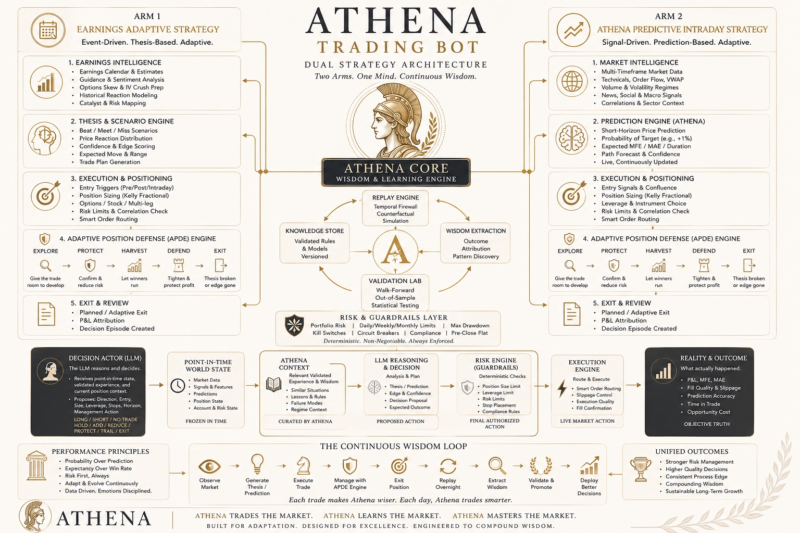

# Athena Trading

**Two Arms. One Mind. Continuous Wisdom.**

Athena Trading combines **Earnings Adaptive** and **Athena Predictive Intraday** through a shared **Astra 6 generative LLM + TypeSafe Jev judge** architecture, Athena Core context and learning, Adaptive Position Defense (APDE), deterministic risk controls, and broker-confirmed execution. This is the owner-approved target, not a claim that the complete system is implemented.

[Read the canonical architecture](docs/ATHENA_TRADING_CANON.md) · [Current implementation](docs/IMPLEMENTATION_STATUS.md) · [Build sequence](docs/BUILD_PLAN.md) · [Documentation index](docs/README.md)



## Start here

| Question | Source |
|---|---|
| What are we building? | [ATHENA_TRADING_CANON.md](docs/ATHENA_TRADING_CANON.md) |
| How do Astra 6, Jev and code divide responsibility? | [HYBRID_MODEL_CONTRACT.md](docs/HYBRID_MODEL_CONTRACT.md) |
| How does it stay online in the cloud? | [CLOUD_DEPLOYMENT.md](docs/CLOUD_DEPLOYMENT.md) |
| How does it learn from trades? | [LEARNING.md](docs/LEARNING.md) |
| How do I start active paper trading? | [LIVE_PAPER.md](docs/LIVE_PAPER.md) |
| What works and what is missing? | [IMPLEMENTATION_STATUS.md](docs/IMPLEMENTATION_STATUS.md) |
| What should the builder do next? | [BUILD_PLAN.md](docs/BUILD_PLAN.md) |
| Which existing code can be reused? | [Repository map](docs/IMPLEMENTATION_STATUS.md#repository-map) |
| What are the old experiments? | [Research index](research/README.md) |
| What did the latest audit find? | [Paper-readiness audit, 10 October 2026](docs/audits/2026-10-10-paper-readiness.md). Prior: [Jev and learning, 24 September 2026](docs/audits/2026-09-24-jev-learning.md) and [inventory](docs/audits/2026-09-24.md). |

## Owner-approved direction — 13 October 2026

Astra 6 interprets timestamped, source-linked events, news and guidance, and proposes structured theses, scenarios and plans with expiry and invalidation. Jev judges bounded choices using the underlying evidence as well as the proposal, including INSUFFICIENT_EVIDENCE. Code owns numbers, validated forecast outputs, freshness, sizing, shared portfolio risk, execution and APDE transitions. Critical protection and exits never wait for either model.

The owner specifically selected **Astra 6**. Its provider deployment/API model ID, account access and SDK support have not been verified; no other model may silently replace it. Model agreement is not independent evidence, and neither model's confidence is a measured probability of profit. Aggressive opportunity capture and adaptive winner management stay within existing risk limits.

## Current reality — main `5708946`

The bounded intraday paper path connects current Alpaca data → strategy candidate → **Jev decision** → deterministic risk → protected paper order and broker-confirmed exit. Jev is the only active model; Terra and Ollama are removed from this path.

Completed trades become verified experience available to later decisions. The cloud supervisor reviews each day after 20:15 Eastern; only prospectively validated, temporary abstention rules can be promoted. See [learning](docs/LEARNING.md) and [cloud deployment](docs/CLOUD_DEPLOYMENT.md).

The first Hostinger paper pilot was installed on 10 October 2026. The dated 13 October incident record documents a filled bracket and protective flatten; earlier “no traded session” summaries are superseded by that record. This work did not inspect the host or establish its current running revision, health or exposure. **LIVE is still rejected.** The fixture lab is not paper evidence. Astra 6 integration, hybrid entry/management, full APDE, comprehensive forecasting, and general Athena Core integration are incomplete. Learning from observations is implemented; improved trading performance is not established.

[Earnings PR #29](https://github.com/nrsandoval1231-oss/athena-trading/pull/29) remains open and unmerged. This dependent branch incorporates its lifecycle repair `daedc2f5849d8468f1a002bd5f34b58b6e45c68c` and adds shared account reservation coordination, a fresh-bar fallback, and offline evaluation machinery. It is a narrower Jev-only paper book, not the Astra 6 hybrid. Nick confirmed no overnight positions on 13 October 2026. New earnings brackets are DAY orders and exits start 15 minutes before the actual session close; old journals remain recoverable. An outage or halt can prevent a confirmed close, so unresolved exposure stays visible and blocks new entries. This branch does not deploy either strategy.

ORB-M is a reusable intraday component and baseline. AAT experiments are research history. The existing Ollama B/C/D runner uses identical empty-memory requests; it does not yet demonstrate Athena learning.

**Execution remains PAPER or ABSENT. LIVE is rejected.** The consumed AAT-V1 holdout remains INVALID_EVIDENCE and must not be reused.

## Local verification and demonstrations

From the repository root, in a Python 3.11+ environment:

```bash
python -m pip install pytest ruff==0.15.8 .
python -m pytest -q
python scripts/run_orb_m_paper.py --walk-bars
python scripts/run_fixture_self_improve.py --out /tmp/fixture-self-improve
```

The bar walk is a fixture demonstration. It is not the completed dual-strategy bot. The self-improve command is an offline mutator on synthetic bars. Its default is three search generations, and authority stays ABSENT. See [FIXTURE_SELF_IMPROVE.md](docs/FIXTURE_SELF_IMPROVE.md).

Astra Desk has moved into its own private [standalone repository](https://github.com/nrsandoval1231-oss/astra-desk). Athena's local/CI verification now covers Athena only; Astra has an independent Python 3.11/3.12 test and lint gate. See the [extraction receipt](docs/ASTRA_DESK_EXTRACTION.md) and [implementation status](docs/IMPLEMENTATION_STATUS.md).
